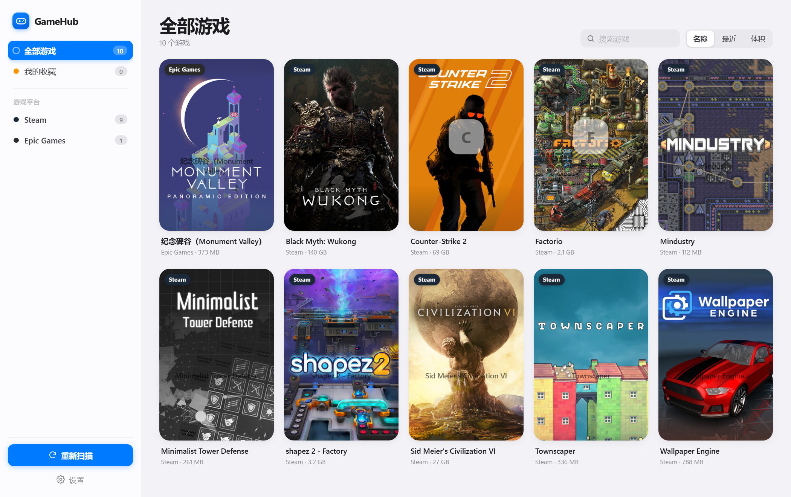

# GameHub · 一站式 Windows 游戏库启动器

自动识别本机所有已安装的游戏，抓取官方宣传海报作为卡片正面，**点一下就能启动**。
轻量、零运行时依赖、iOS 风格界面。



---

## 特性

| | |
|---|---|
| **一键识别** | 自动扫描 Steam / Epic / GOG / Battle.net / EA / Ubisoft / Riot / Xbox / Amazon，以及**本地安装的游戏**和独立游戏 |
| **本地游戏识别** | 识别离线安装 / 免安装 / 绿色版游戏：靠引擎特征（Unity、Unreal、Godot…）+ 本地安装标记判定，不只认商店渠道 |
| **真实游戏体积** | 本地游戏的体积取整个安装目录的实际占用，不是主程序大小 |
| **官方宣传图** | 卡片正面直接使用各平台官方竖版海报（600×900，自带游戏 Logo 与标题文字）；无封面时用 exe 内嵌图标 + 专属渐变兜底 |
| **无 VPN 可用** | 封面取数走 Steam 图片 CDN 与 Epic 官方 GraphQL，国内直连可达，不需要 API Key |
| **点击即启动** | 单击卡片启动游戏，走各平台原生协议（`steam://`、`com.epicgames://`…）或直接运行 exe |
| **系统托盘驻留** | 点窗口的 × 不退出，而是缩到系统托盘；托盘左键可重新打开或完全退出 |
| **开机自启动** | 设置里一键开启，开机后静默驻留托盘（不弹窗口），写注册表 Run 键 |
| **iOS 风格** | 连续圆角、毛玻璃侧栏、系统色板、大标题、分段控件、弹性动画 |
| **轻量** | 后端纯 Python 标准库，无第三方依赖；打包后单文件 exe（约 11 MB） |
| **可离线** | 封面与图标本地缓存，二次打开无需联网 |

---

## 快速开始

### 方式一：直接运行（需要 Python 3.9+）

```bash
双击 run.bat
# 或
python GameHub.py
```

### 方式二：打包成独立 exe（无需 Python 环境）

```bash
双击 build_exe.bat
# 产物： dist\GameHub.exe
```

打包脚本会自动创建虚拟环境、安装 PyInstaller、生成单文件 exe。
若安装了 `pywebview`，会使用真正的原生窗口；否则自动降级为 Edge/Chrome 应用模式窗口（无地址栏，同样是一个独立应用窗口）。

---

## 界面操作

| 操作 | 效果 |
|---|---|
| **单击卡片** | 启动游戏 |
| **双击卡片 / 右键** | 打开详情面板 |
| **卡片右上星标** | 收藏 / 取消收藏 |
| **左侧平台列表** | 按平台筛选（含「本地游戏」分类） |
| **顶部搜索框** | 按名称或平台搜索（`Ctrl+F` 聚焦） |
| **名称 / 最近 / 体积** | 切换排序方式 |
| **重新扫描** | 重新识别全部游戏并刷新封面 |
| **点窗口 ×** | 缩到系统托盘（程序不退出） |
| **托盘左键** | 弹出菜单：打开 GameHub / 完全退出 |
| **Esc** | 关闭弹层 |

---

## 架构

```
GameHub/
├── GameHub.py              入口：起服务 + 注册托盘 + 开窗口 + 首次自动扫描
├── server.py               本地 HTTP 服务（stdlib http.server）与 JSON API
├── server_run.py           仅起服务，用于调试
├── run.bat                 源码运行
├── build_exe.bat           一键打包 exe
│
├── core/
│   ├── models.py           Game 数据模型、平台色板
│   ├── vdf.py              Valve Data Format 解析器（Steam 清单）
│   ├── winutil.py          注册表 / .lnk 解析 / 文件系统工具（纯 stdlib）
│   ├── store.py            游戏库持久化（保留收藏、游玩记录）
│   ├── engines.py          引擎 / 运行时特征识别引擎（规则匹配 + 字面量预筛）
│   ├── icon_extract.py     纯 Python PE 图标提取（取 exe 内嵌 256×256 图标）
│   ├── artwork.py          封面解析：Steam CDN + Epic GraphQL + 商店反查 + 图标兜底
│   ├── launcher.py         启动分派（protocol / exe / shell）
│   ├── tray.py             系统托盘图标（纯 ctypes，适配 pystray 的 Win32 后端）
│   ├── autostart.py        开机自启动（注册表 Run 键）
│   ├── rules/
│   │   └── engines.ini     引擎特征规则集（兼容 SteamDB rules.ini 格式）
│   └── detectors/          各平台检测器
│       ├── steam.py        libraryfolders.vdf + appmanifest_*.acf
│       ├── epic.py         Manifests/*.item (JSON)
│       ├── gog.py          注册表 GOG.com\Games + goggame-*.info
│       ├── battlenet.py    注册表 + product.db (SQLite)
│       ├── ea.py           注册表 EA Games + InstalledContent.csv
│       ├── ubisoft.py      注册表 Ubisoft\Launcher\Installs
│       ├── riot.py         C:\Riot Games\* 目录
│       ├── xbox.py         Get-AppxPackage + XboxGames 目录
│       ├── amazon.py       GameInstallInfo.sqlite
│       ├── local.py        本地安装游戏：引擎特征 + 安装标记 + 结构判定
│       └── standalone.py   开始菜单快捷方式 + 引擎特征扫描
│
├── web/                    iOS 风格前端
│   ├── index.html
│   ├── styles.css          设计系统（系统色板 / 圆角 / 毛玻璃）
│   └── app.js              交互逻辑
│
├── build/
│   ├── icon.svg / icon.ico 应用图标（exe 图标 + 托盘图标共用）
│   └── GameHub.spec        PyInstaller 配置
│
├── docs/                   文档配图
│
└── data/                   运行期数据（自动生成，可删除，已 gitignore）
    ├── library.json        游戏库
    ├── artcache.json       封面缓存
    ├── icons/              exe 提取的图标
    ├── imgcache/           封面图片磁盘缓存
    └── gamehub.log         运行日志
```

---

## 封面图是怎么来的

这是本项目的核心设计，按优先级逐级降级，**全程无需 API Key**：

1. **Steam 游戏** —— 直接用 appid 命中官方 CDN（纯字符串拼接，零网络请求）：
   `https://cdn.cloudflare.steamstatic.com/steam/apps/{appid}/library_600x900.jpg`
   这张就是 Steam 库里的官方竖版海报，自带游戏 Logo 与标题文字。

2. **Epic 官方 GraphQL** —— 按游戏名检索，**不限平台**：
   `POST https://store.epicgames.com/graphql`（`searchStoreQuery`）
   返回 `keyImages`，取 `OfferImageTall`（810×1080 竖版官方图）。
   国内直连可达（实测 0.7s），不需要 API Key。
   Epic 游戏与本地游戏都走这条 —— 只要该作在 Epic 上架过就能拿到官方海报。

3. **Steam 商店反查** —— 用商店公开搜索接口按名称反查 appid，再复用 CDN。
   注意：`store.steampowered.com` 在国内无法直连，需代理或 VPN；
   这也是为什么第 2 条（Epic GraphQL）对国内用户更重要。

4. **可选 SteamGridDB** —— 在「设置」里填入免费 API Key，可获取社区高清网格图，
   显著提升冷门游戏与非 Steam 游戏的封面质量。

5. **兜底** —— 纯 Python 解析 PE 资源目录，提取 exe 内嵌的 256×256 原生图标，
   前端用渐变卡片 + 图标 + 名称合成一张兜底海报。

图片统一经 `/api/img` 代理并落盘缓存，规避防盗链、支持离线复用。

---

## 无 VPN 环境实测

| 数据源 | 国内直连 | 说明 |
|---|---|---|
| Steam 图片 CDN | ✅ 0.24s | 拿到 appid 后取图，主力链路 |
| **Epic GraphQL** | ✅ 0.75s | 按名检索官方竖版海报，非 Steam 游戏的主力链路 |
| SteamGridDB API | ✅ 0.90s | 需免费 Key |
| Steam 商店搜索 | ❌ 超时 | 反查 appid 用，国内不可达 |
| Steam 全量应用表 | ❌ 超时 | 离线名称匹配用，国内不可达 |

因此国内用户的体验是：Steam 游戏靠 CDN 全量出图，Epic 上架过的游戏靠 GraphQL 出图，
其余冷门作建议填一个 SteamGridDB Key 补齐。

---

## 本地游戏识别（离线安装 / 免安装 / 绿色版）

除了商店渠道，GameHub 还会扫描**直接装在磁盘上的游戏**。判定采用
SteamDB FileDetectionRuleSets 的「两遍匹配」思路，按可靠性分三层：

| 层级 | 判据 | 说明 |
|---|---|---|
| **1. 引擎特征** | 命中 `UnityPlayer.dll`、`*-Win64-Shipping.exe`、`data.win`、`Game.ini` 等强特征 | 最可靠。规则集见 `core/rules/engines.ini`，覆盖 160+ 引擎 |
| **2. 安装标记** | `steam_api64.dll`、`steam_emu.ini`、`steam_settings/`、`goggame-*.info`、`*.nfo`，以及目录名里的 `FitGirl` / `DODI` / `R.G. Mechanics` / `CODEX` 等发布组标记 | 离线安装包最典型的特征 |
| **3. 结构特征** | 目录 > 1.2 GB **且** 主程序 > 60 MB **且** 含 `_CommonRedist` 运行库或数据目录 | 三重条件同时满足，普通软件几乎不可能 |

命中任一层即判定为游戏。**宁可漏报也不误判**：实测本机 600 个候选目录中
只识别出 3 个真实游戏（Minecraft 基岩版、The Farmer Was Replaced、一个整合版），
Clash Verge、ComfyUI、MSI Afterburner 等普通软件全部正确排除。

### 关于规则集

`core/rules/engines.ini` 是内置的精选规则集（220+ 条），格式与
[SteamDatabase/FileDetectionRuleSets](https://github.com/SteamDatabase/FileDetectionRuleSets)
的 `rules.ini` **完全兼容**。想用完整版（400+ 条，含 SDK / 反作弊 / 启动器分类）
只需把它下载到 `data/rules/rules.ini`，程序会优先加载：

```bash
curl -L -o data/rules/rules.ini \
  https://raw.githubusercontent.com/SteamDatabase/FileDetectionRuleSets/main/rules.ini
```

加载器会自动把 SteamDB 用的 PCRE 专有语法（`\w++`、`(?>...)`、`{n,m}+`）
降级转换为 Python 兼容写法，并对每条规则抽取字面量做预筛，
把正则执行次数降低一到两个数量级。

### 自定义扫描位置

默认扫描各固定磁盘根目录与 `Games` / `游戏` / `Program Files` 等常见容器。
如需额外位置（比如 `E:\免安装游戏`），在「设置 → 自定义扫描目录」里每行填一个。

### 边界说明

本功能**只读取文件名做识别**，不下载、不修改、不涉及任何破解行为；
启动也只是运行磁盘上已有的 exe。工具本身对游戏来源不作判断。

---

## HTTP API

| 方法 | 路径 | 说明 |
|---|---|---|
| GET | `/api/games` | 全部游戏 |
| POST | `/api/scan` | 触发扫描（后台线程） |
| GET | `/api/scan/status` | 扫描进度 |
| POST | `/api/launch/{id}` | 启动游戏 |
| POST | `/api/favorite/{id}` | 切换收藏 |
| POST | `/api/open-folder/{id}` | 打开安装目录 |
| POST | `/api/add` | 手动添加游戏 |
| DELETE | `/api/game/{id}` | 从库中移除 |
| GET/POST | `/api/config` | 读取 / 保存设置 |
| GET | `/api/img?u=` | 图片代理（带缓存） |
| GET | `/api/icon/{id}.png\|.ico` | exe 内嵌图标（取决于原始格式） |

---

## 开源项目参考

本项目在检测逻辑与启动协议上参考了以下 GitHub 开源实现：

| 项目 | 语言 | 借鉴内容 |
|---|---|---|
| [**Playnite**](https://github.com/JosefNemec/Playnite) | C# / WPF | 平台覆盖范围、统一游戏库模型、启动协议体系、`/IMPORT /RECURSIVE` 文件夹导入思路 |
| [**nexus-launcher**](https://github.com/thebluedogcorp/nexus-launcher) | TypeScript / Electron | 各平台检测来源路径、`detectors/` 模块划分、IPC 分层 |
| [**WindowsGameExport**](https://github.com/johnray/WindowsGameExport) | PowerShell | 独立游戏引擎特征、开始菜单扫描 |
| [**FileDetectionRuleSets**](https://github.com/SteamDatabase/FileDetectionRuleSets) | — | 引擎 / 运行时特征规则集与两遍匹配（Engine 强信号 + Evidence 弱信号累积）的判定思路 |
| [**SteamGridDB**](https://github.com/SteamGridDB) | — | 游戏封面元数据 API 与美术资源规范 |

> 说明：本项目为独立实现，仅借鉴上述项目的公开检测路径、协议约定与规则格式，
> 未复制其源码。所有检测操作**均为只读**，不修改系统上的任何文件。

---

## 常见问题

**Q：为什么有些游戏没有封面？**
A：该游戏不在 Steam 商店中、也未在 Epic 上架，且未配置 SteamGridDB Key。可在设置里填入 Key，或右键该游戏打开详情面板确认安装路径是否正常。

**Q：扫描很慢？**
A：独立游戏扫描需要遍历开始菜单与常见游戏目录，通常 1–3 秒。Steam/Epic 等平台检测是毫秒级的。

**Q：点 × 之后程序去哪了？**
A：缩到系统托盘了，程序仍在后台运行。在任务栏右下角（可能需要点「显示隐藏的图标」箭头）找到 GameHub 图标，左键点击即可重新打开或完全退出。

**Q：会修改我的游戏文件吗？**
A：不会。所有检测都是只读的，启动只是调用各平台自己的启动协议或运行 exe。

**Q：如何彻底重置？**
A：删除 `data/` 目录（源码运行）或 `%LOCALAPPDATA%\GameHub`（exe 运行），下次启动会重新扫描。

---

## 环境要求

- Windows 10 / 11
- 源码运行：Python 3.9+
- exe 运行：无（打包后自带运行时）
- 打包：Python 3.9+ + 网络（下载 PyInstaller）

## 许可与致谢

本项目主体以 **MIT** 许可发布。

系统托盘实现参考并裁剪自 **[pystray](https://github.com/moses-palmer/pystray)**
（Moses Palmér，**LGPL-3.0**）的 Windows 后端。相关代码见 `core/tray.py` 头部注释。
相比原版做了裁剪以保持零第三方依赖：图标改为直接 `LoadImage` + `LR_LOADFROMFILE`
读取 ICO 文件，不再依赖 Pillow。

引擎特征规则集的格式参照 **SteamDatabase/FileDetectionRuleSets**
（[rules.ini](https://github.com/SteamDatabase/FileDetectionRuleSets)）设计，
`core/rules/engines.ini` 为自行整理的规则集，未复制其数据。
